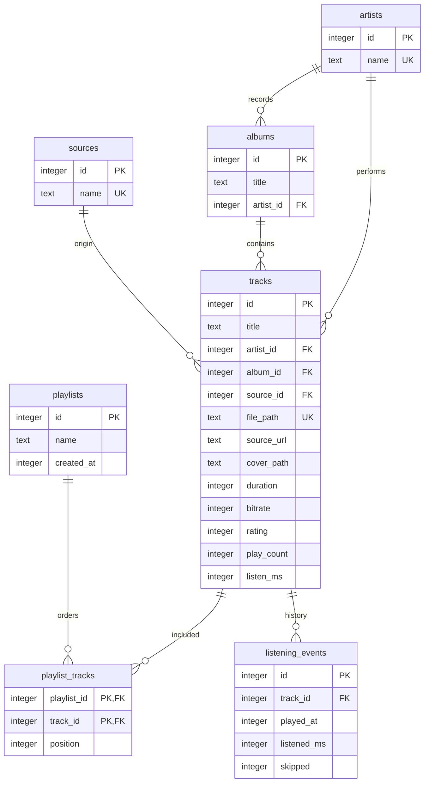

# SQLite-медиатека Aurora

`LibraryRepository` владеет отдельным соединением QSQLITE, сущность `Track` хранит данные трека, `LibraryModel` предоставляет роли QML. Все значения в изменяющих запросах передаются через параметры. Имена таблиц во внутреннем `lookup` выбираются только кодом репозитория.

Схема версии 2 (`PRAGMA user_version=2`), внешние ключи включены для соединения. Используются WAL и `busy_timeout=5000`.



`file_path` допускает NULL для перенесённых записей, у которых пока нет аудиофайла. `rating` ограничен 0–5, время неотрицательно. Состав плейлиста уникален по паре `(playlist_id, track_id)`, порядок — по `(playlist_id, position)`. Удаление плейлиста удаляет его состав; удаление трека удаляет его связи и историю. Аудиофайлы при этом сохраняются.

Представление `track_details` соединяет трек с исполнителем, альбомом и источником, предоставляя модель чтения для интерфейса. Например:

```sql
SELECT d.*
FROM track_details AS d
JOIN playlist_tracks AS p ON p.track_id = d.id
WHERE p.playlist_id = ?
ORDER BY p.position;
```

Индексирование: исполнитель и альбом трека, время последнего воспроизведения, обратная связь трек–плейлист и история по треку/времени. Поиск по строкам выполняет Unicode-сравнение через QString, поскольку встроенный SQLite `NOCASE` не обеспечивает поиск кириллицы без учёта регистра.

Сохранение трека получает или создаёт исполнителя, альбом и источник, затем вставляет трек. Импортированная запись с той же исходной ссылкой получает локальный файл с сохранением её ID и членства в плейлистах. Запись истории и обновление суммарного времени выполняются в одной транзакции. Импорт списка и переносимой медиатеки также используют транзакции.

Миграция старой базы переименовывает таблицу, переносит данные в связанные сущности, сохраняет ID, удаляет старую таблицу и устанавливает версию. Ошибка откатывает все изменения. Автотесты проверяют успешный перенос старой схемы и откат при несовместимой структуре.

Подробный снимок EDM не применялся: по уточнению пользователя его соответствие пока отложено. Текущая модель реализована средствами Qt/C++ и SQLite.
